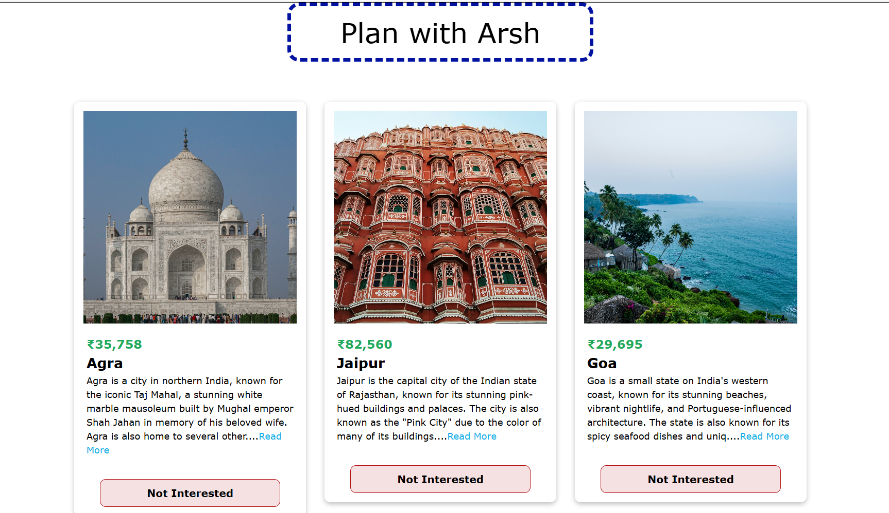

# 🧳 Tour Cards

A responsive React application that allows users to explore popular travel destinations through interactive tour cards. The project demonstrates dynamic state management using React Hooks, conditional rendering, and reusable components while providing a clean and user-friendly interface.

---

## ✨ Features

- 📍 Browse beautiful travel destinations
- 📖 Expand and collapse descriptions with **Read More / Show Less**
- ❌ Remove tours using the **Not Interested** button
- ⚡ Dynamic UI updates using React State
- 🖼️ High-quality local image assets
- 📱 Responsive and clean user interface

---

## 🛠️ Tech Stack

- ⚛️ React
- 🟨 JavaScript (ES6+)
- 🎨 CSS3
- ⚡ Vite
- 🌿 Git & GitHub

---

## 🌐 Live Demo

🔗 https://react-tour-cards-8rzj4u8ew-arsh173.vercel.app/

## 📂 Project Structure

```text
src/
├── assets/
│   └── images/
├── components/
│   ├── Card.jsx
│   └── Tours.jsx
├── data.jsx
├── App.jsx
├── index.css
└── main.jsx
```

---

## 📸 Project Screenshot



---

## 🚀 Getting Started

### Clone the repository

```bash
git clone https://github.com/Arsh173/react-tour-cards.git
```

### Navigate to the project folder

```bash
cd react-tour-cards
```

### Install dependencies

```bash
npm install
```

### Start the development server

```bash
npm run dev
```

---

## 📚 React Concepts Practiced

- Functional Components
- Props
- useState Hook
- Conditional Rendering
- Event Handling
- Array Mapping
- Component Composition
- Local Asset Management

---

## 🎯 Future Improvements

- 🔍 Search Tours
- 🏷️ Filter Tours by Destination
- ❤️ Add Favorite Tours
- 🌙 Dark Mode
- ✨ Smooth Animations
- 💾 Store user preferences using Local Storage

---

## 👨‍💻 Author

**Arsh**

- GitHub: https://github.com/Arsh173
- LinkedIn: https://linkedin.com/in/arsh0786

---

## ⭐ Support

If you found this project helpful, consider giving it a ⭐ on GitHub!